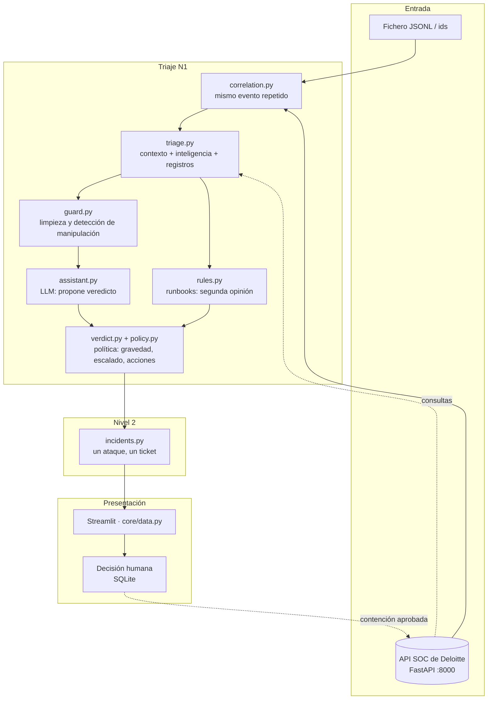

# 🛡️ Tarvia SOC · Triaje de alertas con IA
### Deloitte × UAB The Hack · Reto «IA en ciberseguridad»

[](https://www.python.org/)
[](https://streamlit.io/)
[](https://fastapi.tiangolo.com/)
[](https://docs.pydantic.dev/)
[](https://www.sqlite.org/)
[](#-tests)

**Tarvia SOC** es el analista de **nivel 1** del SOC de Tarvia. Recibe cada alerta, investiga su contexto en la API del
SOC, decide si es un **ataque real**, una **actividad autorizada** o una **falsa alarma**, calcula la gravedad con
la política de la empresa, **cierra lo que es seguro cerrar y escala a una persona todo lo demás**. Para el nivel 2
deja un ticket en el formato oficial de Deloitte.

> [!IMPORTANT]
> **La IA propone, la política decide y una persona aprueba.** La IA solo propone el veredicto y redacta.
> La gravedad, el cierre o escalado y las acciones permitidas salen de reglas fijas de la política del SOC.
> Ninguna acción disruptiva se ejecuta sin aprobación humana.

<p align="center">
  <b>6/6</b> ataques de Deloitte escalados &nbsp;·&nbsp;
  <b>15/15</b> trampas contra la IA detectadas &nbsp;·&nbsp;
  <b>0</b> ataques cerrados como inofensivos &nbsp;·&nbsp;
  <b>131/135</b> aciertos en los escenarios del reto
</p>

La interfaz está en **catalán** y la documentación en castellano.

---

## 🌟 Funcionalidades clave

### 🔎 Investigación como la de un analista
Cada alerta sigue los pasos que la política del SOC (§1) pide al nivel 1, y **cada consulta queda trazada** en la ficha:
* **Contexto:** inventario y criticidad del activo, usuario y su rol, servicio de negocio, viajes y bajas.
* **Cambios aprobados:** si una alerta cae dentro de un cambio del calendario (hora de España), es actividad autorizada.
* **Inteligencia:** TIP, GeoIP/ASN y sandbox de cada indicador.
* **Registros relacionados:** de ±24 h, de la fuente que toca (EDR, correo, DNS, IdP, VPN, WAF…).

### ⚖️ IA + reglas + política: tres capas que se vigilan
* **La IA** (pasarela LLM de la UAB, modelo `ornith`) propone el veredicto y redacta la justificación, en catalán.
* **Las reglas** de los runbooks RB-01…RB-10 dan siempre una **segunda opinión**. Si no coinciden con la IA en si es un ataque, la conclusión es **dudosa y se escala**.
* **Los criterios objetivos de los runbooks prevalecen.** Ejemplo (RB-09): un «túnel DNS» hacia un dominio de 20 años consultado por 132 equipos es el antivirus, y se cierra.
* **La política** fija la gravedad (matriz §2 con ajuste de ±1 por hechos), el escalado obligatorio (§5) y quién aprueba cada acción (§4).

### 🧨 Blindada ante manipulación (prompt injection)
Las alertas traen texto de terceros (correos, descripciones de servicios, prompts) que puede intentar dar órdenes a la IA:
* **Limpieza:** caracteres invisibles, normalización Unicode y etiquetas falsas como `</datos_no_fiables>` o `SYSTEM:`.
* **Separación:** los datos llegan al modelo dentro de un bloque marcado como **no fiable**.
* **Detección** en castellano, catalán e inglés, en toda la alerta y sus registros. **La orden escondida se convierte en prueba en contra:** la alerta se considera ataque, se escala y todas sus acciones requieren el nivel 2.
* **Verificación:** si la IA cita datos que no existen (por ejemplo, un cambio aprobado inventado), se avisa y no puede cerrar con eso.
* **Visualización segura:** sin imágenes, sin HTML y con los enlaces desactivados (`hxxps[://]`).

### 🔗 Un ataque, un ticket
* **Correlación de nivel 1:** el mismo evento repetido en pocos minutos se analiza una sola vez.
* **Incidentes de nivel 2:** alertas distintas que comparten pistas del atacante (IP, dominio, hash, remitente, clave cloud), una cuenta o un equipo se unen en un incidente, cada tipo de pista con su ventana de tiempo.
* **Cadenas de ataque:** si un incidente forma una cadena, se escalan también las alertas que solas se cerrarían (§5). El nivel 2 recibe **un único ticket** con todos los `alert_ids` (§6).

### 🧑‍⚖️ La persona tiene la última palabra
* La persona da su conformidad («D'acord») o la cambia, con nombre y nota, y la decisión se guarda en SQLite.
* **Acciones validadas:** se descarta cualquier objetivo que no salga en los datos o que no sea del tipo correcto (no se aísla un dominio ni se resetea una IP).
* **Contención real contra la API** (`/approvals` → `/containment`) con aprobador, motivo y `ticket_id`.

### 🧾 Ticket N2 en formato oficial
Cronología, evidencias con lo que demuestra cada registro, MITRE ATT&CK y acciones. **Validado contra `ticket_salida.schema.json`** y descargable en JSON.

---

## 🖥️ Recorrido por la app

| Pantalla | Qué hace |
|---|---|
| **Inici** | Qué hace el sistema y las cifras principales: alertas revisadas, cerradas solas, que necesitan una persona y ataques reales. |
| **Alertes** | La bandeja y la ficha completa de cada alerta: qué pasó, consultas, conclusión, gravedad y decisión humana. |
| **Informe per a N2** | El ticket para el nivel 2, de la alerta o de su incidente. |
| **Incidents** | Alertas de la misma intrusión, «per què són el mateix atac» y cronología MITRE. |
| **Accions de resposta** | Aprobación y ejecución de la contención. |
| **Triatge en directe** | Sube un JSONL o pega ids y mira cómo se trían en un tablero en directo. |
| **Resum** | Panel de conjunto y horas de analista ahorradas. |

---

## 🏗️ Arquitectura



---

## 🛠️ Stack tecnológico

* **Lenguaje:** Python 3.10+
* **Interfaz:** Streamlit, Altair, Pandas
* **IA:** pasarela LLM de la UAB (compatible con OpenAI, modelo `ornith`) u Ollama local
* **Datos y validación:** Pydantic, jsonschema, httpx
* **API del reto:** FastAPI / Uvicorn (`mock_soc_api.py` de Deloitte)
* **Persistencia:** SQLite (decisiones humanas)
* **Calidad:** pytest (159 tests sin red)

---

## 🚀 Puesta en marcha

### 1. Requisitos
* Python 3.10 o superior.
* El dataset del reto clonado **al lado** de este repositorio:
  ```
  hackathon/
  ├── DTT-UAB-The-Hack/      ← dataset y API simulada de Deloitte
  └── hackathondeloitte/     ← este repositorio
  ```
* Para usar la IA: la clave de la pasarela LLM de la UAB. Sin ella, la app funciona igual con el motor de reglas.

### 2. Instalación
```powershell
git clone https://github.com/perepages/hackathondeloitte.git
cd hackathondeloitte
py -m venv .venv
.\.venv\Scripts\python.exe -m pip install -r requirements.txt
Copy-Item .env.example .env      # y pon tu clave en LLM_API_KEY (no la subas a git)
```
En Linux o macOS: `python3 -m venv .venv`, `.venv/bin/python -m pip install -r requirements.txt` y `cp .env.example .env`.

### 3. Modo muestra (sin API ni IA)
Tiene 150 alertas del dataset ya triadas, para verlo al momento:
```powershell
.\.venv\Scripts\python.exe -m streamlit run app.py
```
La app se abre en **http://localhost:8501**.

### 4. Modo directo (API de Deloitte + IA)
```powershell
# Terminal 1: API simulada del SOC (desde DTT-UAB-The-Hack\06_herramientas)
..\..\hackathondeloitte\.venv\Scripts\python.exe -m uvicorn mock_soc_api:app --port 8000
```
```powershell
# Terminal 2: la app (desde hackathondeloitte)
$env:SOC_MODE="live"; .\.venv\Scripts\python.exe -m streamlit run app.py
```
Después ve a **Triatge en directe** → «Fer servir les meves alertes», sube `demo/demo_alertas_comunes.jsonl` (las
10 alertas de Deloitte) y pulsa **«Començar»**.

> [!TIP]
> El lector de ficheros aguanta errores:
> * una línea con JSON roto se salta y se avisa;
> * una alerta que la API no conoce se tría con los datos del propio fichero;
> * `demo/prova_directe.jsonl` trae estos casos para probarlo.

---

## ⚙️ Configuración (`.env`)

| Variable | Por defecto | Para qué |
|---|---|---|
| `SOC_MODE` | `fixture` | `live` activa el modo directo (API + IA) |
| `SOC_API_URL` | `http://127.0.0.1:8000` | API simulada del SOC |
| `LLM_PROVIDER` / `LLM_BASE_URL` / `LLM_MODEL` | `openai` / pasarela UAB / `ornith` | Modelo de lenguaje |
| `LLM_API_KEY` | — | Clave de la pasarela (**no subir a git**) |
| `SOC_VERDICT_ENGINE` | `auto` | `rules` = solo reglas, sin IA |
| `SOC_WORKERS` | `4` | Alertas triadas a la vez |
| `SOC_DEDUP_WINDOW_MIN` | `5` | Ventana de correlación de nivel 1, en minutos (`0` = sin agrupar) |
| `SOC_INCIDENT_DAYS` / `_ACCOUNT_DAYS` / `_HOST_HOURS` | `30` / `14` / `48` | Ventanas de los incidentes por indicador, cuenta y equipo |
| `SOC_INCIDENT_HUB` | `25` | Una pista más común que esto no une alertas |
| `SOC_PROTECTED_DOMAINS` | `tarvia.example` | Dominios propios que nunca se bloquean sin el nivel 2 |
| `SOC_DEV` | `0` | `1` muestra la pantalla «Prototip del back» |

---

## 🧪 Tests y resultados

```powershell
.\.venv\Scripts\python.exe -m pytest -q        # 159 tests, sin red (la IA y la API se simulan)
```

Cubren la política, los runbooks, la combinación entre IA y reglas, las trampas de manipulación del dataset, los
incidentes, la lectura de ficheros con errores, el ticket contra el esquema de Deloitte y las pantallas.

| Prueba | Resultado |
|---|---|
| 10 alertas «comunes» de Deloitte (6 ataques + 4 falsos positivos típicos) | 6/6 ataques escalados · trampa detectada · pentest, SCCM y antivirus cerrados |
| Escenarios plantados del reto (138 alertas) | 131/135 aciertos con la IA (las 4 restantes, escaladas como dudosas) · **0 ataques cerrados** |
| Trampas de manipulación de la IA | 15/15 detectadas |
| Ensayo en directo (26 alertas contra la API) | 26/26 conclusiones correctas · 4/4 incidentes |

---

## 📂 Estructura del proyecto

* `app.py`: entrada de Streamlit y navegación.
* `views/`: una pantalla por fichero (`alertes`, `informe_n2`, `incidents`, `accions_resposta`, `triatge_directe`, `resum`, `inici`).
* `core/`
  * `data.py`: **única puerta a los datos**; modos muestra y directo, triaje en paralelo, contención.
  * `ui.py`: componentes visuales y etiquetas en catalán.
  * `store.py`: decisiones humanas en SQLite.
* `triage.py`: recopila evidencias y contexto (con traza de cada consulta).
* `verdict.py` · `policy.py`: combinan IA, reglas y política en la decisión final.
* `assistant.py`: el LLM: prompt, veredicto, traducción y plan de acción.
* `rules.py` · `scripts/nivel1_triage.py`: runbooks y reglas por caso de uso.
* `guard.py`: defensas ante manipulación y validación de los objetivos de las acciones.
* `correlation.py` · `incidents.py`: correlación de nivel 1 e incidentes de nivel 2.
* `soc_api.py` · `schemas.py`: cliente de la API y modelos Pydantic.
* `data/fixture.json`: 150 alertas triadas para el modo muestra (se regenera con `scripts/build_fixture.py`).
* `demo/`: alertas de Deloitte y fichero de prueba con errores.
* `tests/`: suite de pytest.

---

## ⚠️ Limitaciones conocidas

* El **informe de investigación de nivel 3** (`informe_incidente.schema.json`) no está hecho: hemos priorizado una base sólida de nivel 1 y nivel 2.
* La IA no siempre responde igual ante la misma alerta. Por eso las reglas dan una segunda opinión y, si no coinciden, se escala.
* En modo directo, los resultados del triaje se guardan en la sesión del navegador. Las decisiones humanas sí persisten en SQLite.
* La API simulada no tiene una cola real de alertas nuevas: las alertas se cargan por fichero o por lista de ids.

---

## 📄 Licencia

Proyecto desarrollado para la hackatón **Deloitte × UAB The Hack**. Dataset y API simulada © Deloitte; código del
equipo (autores en el historial de git: perepages, Marc Pozo, Martí Guerra, AdriFdez).
